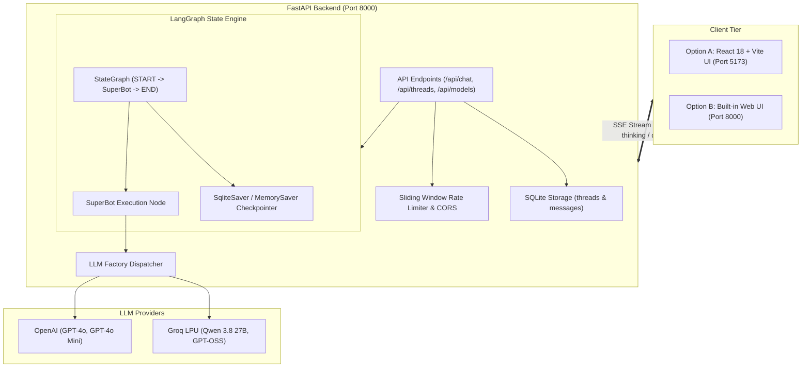

# 🤖 SuperBot — Production LangGraph AI Assistant

<p align="center">
  
  
  
  
  
  
  
  
  
</p>

An AI chatbot built using **LangGraph, FastAPI, and React 18**, with an optional Vanilla JavaScript web interface. It supports conversation history, real-time response streaming, SQLite-based persistence, and multiple models from Groq and OpenAI. It also includes support for displaying `<think>` tags from compatible reasoning models.

---


## Key Features

- **Conversational Memory:** Uses LangGraph and checkpointing to retain conversation history across turns and sessions.
- **Real-Time Streaming:** Streams responses using FastAPI and Server-Sent Events (SSE), with support for stopping generation.
- **Thinking Process Display:** Extracts `<think>` tags from supported models and displays them in expandable sections.
- **Multiple LLM Providers:** Supports Groq models, including Qwen and GPT-OSS, along with OpenAI models such as GPT-4o and GPT-4o Mini.
- **Two Frontend Options:**
  - A lightweight web interface built with HTML, CSS, and JavaScript.
  - A React and TypeScript application with chat history, dark/light mode, code highlighting, copy buttons, and speech input.
- **Basic Security:** Includes IP-based rate limiting, input validation, error handling, and keeps API keys on the backend.
---

## 🏗️ Architecture



---

## 📁 Repository Structure

```text
├── app.py                     # Main FastAPI server launcher (Port 8000)
├── run.bat                    # One-click Windows runner for root app
├── requirement.txt            # Python dependencies
├── .env.example               # Template environment configuration
├── .gitignore                 # Comprehensive Git ignore rules
│
├── backend/                   # Root backend implementation
│   ├── bot_graph.py           # LangGraph StateGraph, MemorySaver & SSE streaming
│   └── server.py              # FastAPI endpoints & static file hosting
│
├── static/                    # Root Web UI
│   ├── index.html             # Responsive chat interface
│   ├── css/style.css          # Glassmorphic, modern CSS styles
│   └── js/app.js              # SSE consumer, audio/speech & chat logic
│
├── chatbot-app/               # Modular Full-Stack React + FastAPI App
│   ├── backend/               # Enterprise FastAPI service with SQLite persistence
│   │   ├── app/               # Routes, schemas, graph engine, storage
│   │   ├── Dockerfile         # Backend container definition
│   │   └── requirements.txt   # Backend requirements
│   ├── frontend/              # React 18 + TypeScript + Vite frontend
│   │   ├── src/               # ChatWindow, Composer, Sidebar, Hooks
│   │   └── package.json       # Frontend dependencies
│   ├── run_backend.bat        # Windows launcher for React app backend
│   ├── run_frontend.bat       # Windows launcher for Vite dev server
│   └── docker-compose.yml     # Multi-container orchestration
│
├── ChatBot/                   # Exploratory Jupyter Notebooks
│   └── 2-chatbot.ipynb        # Foundational LangGraph multi-turn notebook
└── langgraph/
    ├── basic.ipynb            # LangGraph introductory concepts
    └── chatbot.ipynb          # State graph prototyping
```

---

## 🚀 Getting Started

### 1. Prerequisites
- **Python**: Version `3.10` or higher
- **Node.js**: Version `18.x` or higher (only needed if running `chatbot-app` frontend)
- **API Keys**: An API key for [Groq](https://console.groq.com/) and/or [OpenAI](https://platform.openai.com/)

---

### 2. Environment Setup

Create a `.env` file in the root directory (refer to `.env.example`):

```bash
# Copy example configuration
cp .env.example .env
```

Add your API keys to `.env`:
```ini
OPENAI_API_KEY="your-openai-api-key-here"
GROQ_API_KEY="your-groq-api-key-here"
LANGCHAIN_API_KEY="your-optional-langchain-key"
```

---

### 3. Run Option A: Integrated Web UI (Quickest)

The root app serves both the backend API and the web interface from a single port:

```bash
# 1. Create and activate a virtual environment
python -m venv venv
.\venv\Scripts\activate   # On Windows (or 'source venv/bin/activate' on Linux/macOS)

# 2. Install dependencies
pip install -r requirement.txt

# 3. Launch the application
python app.py
# (Or on Windows simply double-click run.bat)
```

Open your browser and navigate to:  
👉 **[http://localhost:8000](http://localhost:8000)**

---

### 4. Run Option B: Full-Stack React App (`chatbot-app`)

If you want to use the full React 18 + TypeScript interface:

#### Start the Backend:
```bash
cd chatbot-app/backend
pip install -r requirements.txt
uvicorn app.main:app --host 0.0.0.0 --port 8000 --reload
# (Or double-click chatbot-app/run_backend.bat)
```

#### Start the Frontend:
```bash
cd chatbot-app/frontend
npm install
npm run dev
# (Or double-click chatbot-app/run_frontend.bat)
```

Open your browser and navigate to:  
👉 **[http://localhost:5173](http://localhost:5173)**

---

### 5. Run Option C: Docker Compose

To launch the full-stack containerized setup:

```bash
cd chatbot-app
docker-compose up --build
```

---

## 📡 API Overview

| Method | Endpoint | Description |
| :--- | :--- | :--- |
| `GET` | `/api/health` | Service status & configured LLM provider keys check |
| `GET` | `/api/models` | List available models and provider availability |
| `POST` | `/api/chat/stream` | Token-level SSE streaming endpoint (`text/event-stream`) |
| `POST` | `/api/chat` | Synchronous / non-streaming chat fallback |
| `GET` | `/api/threads` | List saved conversation sessions (in `chatbot-app`) |
| `GET` | `/api/threads/{thread_id}` | Retrieve history turns for a specific thread |
| `DELETE` | `/api/threads/{thread_id}` | Delete or clear a conversation thread |

Interactive Swagger documentation is available at:  
👉 **[http://localhost:8000/docs](http://localhost:8000/docs)**

---

## 🧪 Testing

Run backend acceptance and unit tests:
```bash
# In chatbot-app/backend:
pytest tests/
python tests/verify_acceptance.py
```

Run frontend test suites:
```bash
# In chatbot-app/frontend:
npm test
```


---

## 📄 License

This project is licensed under the [MIT License](LICENSE).
