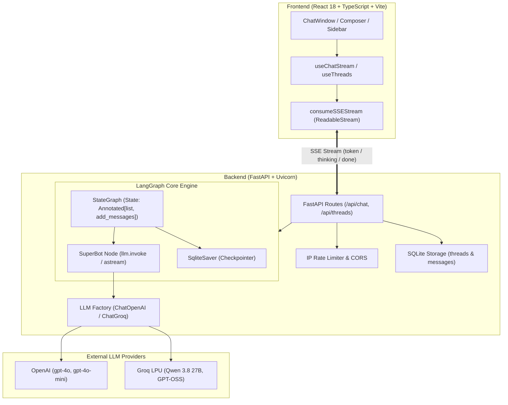

# SuperBot AI - Production LangGraph Chatbot Web Application

A full-stack, production-quality AI Chatbot application built around **LangGraph**, featuring Server-Sent Events (SSE) token-level streaming, conversational memory checkpointers, reasoning `<think>` tag extraction, SQLite persistence, and a modern ChatGPT/Claude-inspired React 18 + TypeScript interface.

---

## Architecture Overview



---

## Key Features

1. **True Conversational Memory**:
   - Preserves the LangGraph reducer schema `class State(TypedDict): messages: Annotated[list, add_messages]`.
   - Utilizes `SqliteSaver` checkpointer with `thread_id` so earlier conversational turns (e.g. "My name is Krish") are remembered seamlessly across sessions and turns.
2. **Server-Sent Events (SSE) Streaming**:
   - Token-by-token streaming via `graph.astream(..., stream_mode="messages")`.
   - Live stream abort via standard `AbortController` ("Stop" button).
3. **Reasoning Model Support**:
   - Automatically detects `<think>...</think>` tags from reasoning models and routes them to a dedicated `thinking` event stream.
   - UI displays a collapsible "Thinking..." block with word count and progress.
4. **Resilience & Security**:
   - Input length validation (`max_length: 4000`).
   - Per-IP rate limiting (sliding window).
   - Graceful error bubbles with inline Retry buttons and toast notifications.
   - API keys are securely kept on backend and never exposed to the client.
5. **Modern Frontend Experience**:
   - Collapsible responsive sidebar with conversations grouped by **Today**, **Yesterday**, and **Previous 7 days**.
   - URL synchronization (`/chat/:threadId`) to restore chat history on page refresh.
   - Dark / Light / System theme toggle with `localStorage` persistence.
   - Markdown rendering with tables, lists, links, and PrismJS syntax-highlighted code blocks with a one-click copy button.

---

## Project Structure

```
chatbot-app/
├── backend/
│   ├── app/
│   │   ├── main.py            # FastAPI app, CORS, rate limiting, lifespan, error handlers
│   │   ├── config.py          # Settings from .env, model registry, available models filter
│   │   ├── graph.py           # LangGraph State, SuperBot node, graph compiler & cache, checkpointer
│   │   ├── llm_factory.py     # Provider dispatch: ChatGroq & ChatOpenAI with validation
│   │   ├── schemas.py         # Pydantic v2 schemas for chat, threads, models, and errors
│   │   ├── storage.py         # SQLite persistence for threads & messages history
│   │   └── routes/
│   │       ├── chat.py        # /api/chat/stream (SSE), /api/chat, /api/models
│   │       └── threads.py     # Thread CRUD: /api/threads (GET, POST, PATCH, DELETE)
│   ├── tests/
│   │   ├── test_graph.py      # Unit test: state, superbot node, checkpointer memory
│   │   └── test_api.py        # Integration test: endpoints, rate limit, model availability
│   ├── requirements.txt
│   ├── .env.example
│   └── Dockerfile
│
├── frontend/
│   ├── src/
│   │   ├── components/        # ChatWindow, MessageList, MessageBubble, Composer, Sidebar, etc.
│   │   ├── hooks/             # useChatStream, useThreads, useTheme
│   │   ├── lib/               # api.ts, sse.ts, types.ts
│   │   ├── App.tsx, main.tsx, index.css
│   ├── tests/
│   │   ├── sse.test.ts        # Vitest suite for SSE chunk parser
│   │   └── useChatStream.test.ts
│   ├── package.json, tailwind.config.ts, vite.config.ts
│   └── Dockerfile
│
├── docker-compose.yml
└── README.md
```

---

## Quick Start & Running Locally

### Prerequisites
- Python 3.10+ (Python 3.11+ recommended)
- Node.js 18+ and npm

### 1. Backend Setup
1. Navigate to the backend directory:
   ```bash
   cd chatbot-app/backend
   ```
2. Create and activate a virtual environment (optional if using global Python):
   ```bash
   python -m venv venv
   # Windows:
   venv\Scripts\activate
   # macOS/Linux:
   source venv/bin/activate
   ```
3. Install dependencies:
   ```bash
   pip install -r requirements.txt
   ```
4. Configure your `.env` file:
   ```bash
   cp .env.example .env
   ```
   Add your API keys:
   ```env
   OPENAI_API_KEY=sk-...
   GROQ_API_KEY=gsk_...
   DEFAULT_MODEL=gpt-4o
   ```
5. Run the backend development server:
   ```bash
   uvicorn app.main:app --reload --port 8000
   ```
   *The backend will be available at `http://127.0.0.1:8000` (API docs at `/docs`).*

### 2. Frontend Setup
1. Open a new terminal and navigate to the frontend directory:
   ```bash
   cd chatbot-app/frontend
   ```
2. Install dependencies:
   ```bash
   npm install
   ```
3. Run the Vite development server:
   ```bash
   npm run dev
   ```
   *Open your browser and navigate to `http://localhost:5173`.*

---

## Running with Docker Compose

To run both backend and frontend in isolated containers:
```bash
cd chatbot-app
docker-compose up --build
```
- Frontend: `http://localhost:3000`
- Backend: `http://localhost:8000`

---

## API Reference & Curl Examples

### 1. Health Check
```bash
curl -X GET http://127.0.0.1:8000/api/health
```
**Response:**
```json
{
  "status": "healthy",
  "providers": { "openai": true, "groq": true },
  "default_model": "gpt-4o",
  "version": "1.0.0"
}
```

### 2. List Models
```bash
curl -X GET http://127.0.0.1:8000/api/models
```

### 3. Stream Chat (Server-Sent Events)
```bash
curl -N -X POST http://127.0.0.1:8000/api/chat/stream \
  -H "Content-Type: application/json" \
  -d '{
    "message": "Hi, my name is Krish and I like cricket.",
    "model": "gpt-4o",
    "temperature": 0.7
  }'
```

### 4. Conversation Memory Turn 2
```bash
curl -N -X POST http://127.0.0.1:8000/api/chat/stream \
  -H "Content-Type: application/json" \
  -d '{
    "thread_id": "<THREAD_ID_FROM_PREVIOUS_TURN>",
    "message": "What is my name and hobby?",
    "model": "gpt-4o"
  }'
```

### 5. Thread CRUD
- **List threads**: `GET /api/threads`
- **Create thread**: `POST /api/threads` (`{"title": "My Topic"}`)
- **Get thread history**: `GET /api/threads/{thread_id}`
- **Rename thread**: `PATCH /api/threads/{thread_id}` (`{"title": "New Title"}`)
- **Delete thread**: `DELETE /api/threads/{thread_id}`

---

## How to Add a New Model

Adding a new model to SuperBot is modular and requires two simple edits:

1. Open `backend/app/config.py` and append your model to `MODEL_REGISTRY`:
   ```python
   {
       "id": "claude-3-5-sonnet-20241022",
       "label": "Claude 3.5 Sonnet",
       "provider": "Anthropic",
       "badge": "⚡ Vision & Code",
       "description": "Anthropic high-speed frontier model",
       "supports_thinking": False
   }
   ```
2. Open `backend/app/llm_factory.py` and add the provider instantiation branch:
   ```python
   elif provider == "Anthropic":
       from langchain_anthropic import ChatAnthropic
       api_key = os.getenv("ANTHROPIC_API_KEY")
       if not api_key:
           raise ValueError("Anthropic API key is missing. Set ANTHROPIC_API_KEY in .env")
       return ChatAnthropic(model=resolved_id, temperature=temperature, api_key=api_key)
   ```
3. Restart the backend. The frontend will automatically display the new model with its badge in the dropdown!

---

## Running Tests

### Backend Tests (pytest)
```bash
cd chatbot-app/backend
pytest tests -v
```

### Frontend Tests (Vitest)
```bash
cd chatbot-app/frontend
npm test
```
